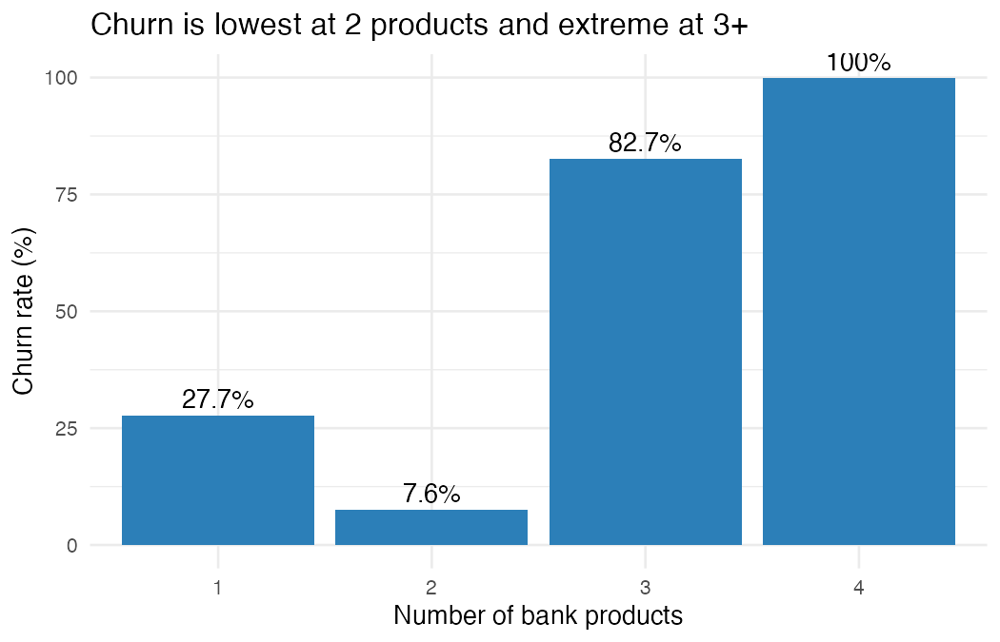
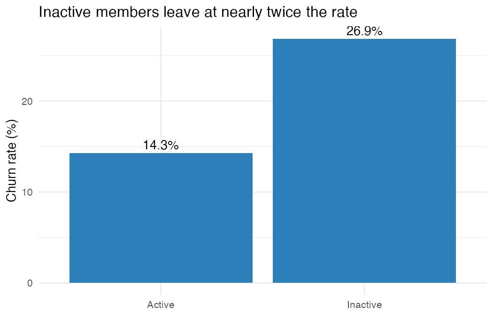
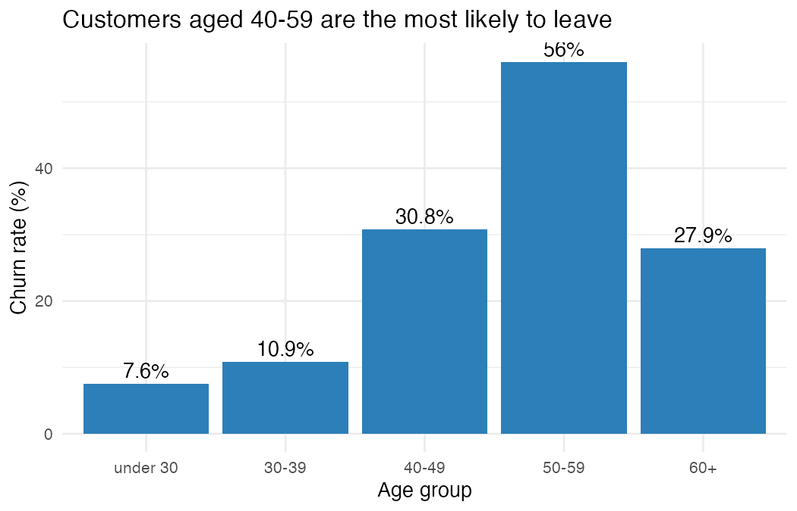

# Bank Customer Churn Analysis

**Which customers are leaving a bank, and what should the bank do about it?**
An analysis of 10,000 bank customers using R, SQL (MySQL) and Quarto, ending in four retention recommendations.

## Business problem
The bank loses about 1 in 5 customers (20.4% churn). Keeping an existing customer costs far less than winning a new one, so this project identifies who is leaving and where retention effort would pay off.

## Key findings

**1. One-product customers drive most of the churn, and 3+ products is a red flag.**
Customers with two products are the most loyal (7.6% churn). Single-product customers leave at 27.7% and account for roughly 69% of all churn. Nearly everyone holding 3 or 4 products left, although that group is small (326 customers).

**2. Inactive members leave at nearly twice the rate of active ones.**
26.9% vs 14.3%. Inactive members are about 48% of customers but roughly 64% of churn.

**3. Customers aged 40-59 are the most likely to leave.**
Churn peaks at 56% for ages 50-59. Ages 40-59 are about 35% of customers but roughly 63% of churn.

**Supporting finding:** Germany has a 32.4% churn rate, about double France (16.2%) and Spain (16.7%).

## Recommendations
1. Re-engage inactive members before they leave.
2. Investigate why customers with 3+ products leave (fees, bundling, how they are sold).
3. Pilot a second-product offer for single-product customers and measure the effect.
4. Prioritise retention efforts for customers aged 40-59 and in Germany.

## Limitations
The data is a snapshot, so these are associations, not proven causes. There is no revenue data, so the dollar value of the recommendations is not estimated.

## Tools
R (tidyverse, ggplot2), SQL (MySQL Workbench), Quarto

## Files
- `01_clean.R` - data cleaning and feature creation
- `02_queries.sql` - SQL analysis queries
- `03_charts.R` - charts
- `report.qmd` and `report.html` - written report
- `churn_by_*.png` - chart images

## Data
Kaggle "Churn Modelling" dataset (bank customers, 10,000 rows). Download it from https://www.kaggle.com/datasets/shrutimechlearn/churn-modelling and save it as `Churn_Modelling.csv` in a `data` folder to re-run the scripts.
